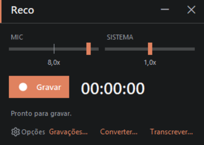

# Reco

**Record your microphone *and* your computer's audio at the same time, then transcribe it locally — with speaker separation.**

A small desktop app that captures the mic and the system output together
(real WASAPI loopback — no "Stereo Mix" needed), saves a compact MP3, and
transcribes it **on your machine**, labeling who said what. Nothing is uploaded.
The interface is bilingual (Portuguese / English), auto-detected from your system.

Transcription runs in-process via **OpenVINO GenAI** on Windows/Linux (Intel
**iGPU → NPU → CPU**, auto-selected) and via **MLX** on macOS Apple Silicon — so
the bundled app is fully self-contained (no Python, no ffmpeg).

<p align="center">
  
</p>

---

## English

### Features
- 🎙️ **Mic + system audio together** — capture a call/meeting with both sides, via
  true WASAPI loopback (works even when "Stereo Mix" is disabled).
- 🗣️ **Channel diarization** — the mic and the system are kept on separate channels,
  so the transcript is labeled **"Eu" / "Me"** (you) and **"Interlocutor(es)" /
  "Speaker(s)"** (the other side). Always on.
- 🔇 **Echo cancellation** — if you're on speakers, the PC audio leaking into the
  mic is removed (offline adaptive filter using the loopback as reference), so the
  other party isn't duplicated across both channels.
- 📊 Live level meters for mic and system, each with a **draggable gain slider** —
  drag the handle over a meter to boost or attenuate what that channel records.
  Center is unity (**1.0×**, no change); left attenuates down to 0×, right boosts
  up to **10×**, and the current multiplier is shown under the bar. Handy when the
  mic records much quieter than the system audio. The gain is baked into the saved
  file and remembered between sessions.
- ⏸️ **Pause / resume** a recording before saving — paused time is dropped from the
  audio and from the clock, so a break doesn't end up in the file.
- 🔔 **Lives in the tray** — closing the window hides Reco into the notification area
  (a recording keeps running, and the icon shows a red dot with the elapsed time).
  **Hover** the icon to bring the compact window back over the tray (stop, start,
  convert, transcribe); **click** to pin it; **right-click** for Record/Stop,
  Pause/Resume, Open and Quit. Quitting mid-recording saves the MP3 first.
- 🎧 Saves a compact **MP3** (16 kHz stereo, 96 kbps — small, plenty for speech),
  encoded *while* recording, so stopping is instant no matter how long the meeting was.
- 📋 **Save and copy the path** — after stopping, the main button saves the recording
  and copies its full path, already in double quotes, ready to paste into a terminal
  or chat. Hover it for the other choices (save + transcribe, save only, transcribe + delete).
- 📝 **Local transcription** that auto-saves a `.txt` next to your recordings. No
  cloud, fully private.
- 🔴 **Live transcription (draft)** — optional, off by default (Options): shows
  text as you record, on the iGPU. It's a *draft* — closed-segment (VAD-based),
  not a sliding window, so lines never rewrite themselves once they appear.
  When you stop, a final pass (same engine as regular transcription — channel
  diarization + echo cancellation + dominance) replaces the draft. **New** —
  try it on one of your own meetings before relying on it for a long recording.
- 🎵 **MP4 → MP3** — pick a video (or a heavy audio file) in the Transcribe view and
  hit *Extract MP3*: it re-encodes to the same lightweight format Reco records in
  (16 kHz mono, 64 kbps), typically a fraction of the original size. The MP3 is
  saved next to the source and stays selected, ready to transcribe.
- 🗂️ **Recordings library** — the *Recordings…* view lists everything in your
  recordings folder (date, length, transcript status) and searches by file
  name **and transcript content**. Play, transcribe, open the .txt or delete
  (to the Recycle Bin) from one place.
- ✦ **AI summary (optional)** — with [Claude Code](https://claude.com/claude-code)
  installed, one click turns a transcribed recording into `<name>.resumo.md`
  (summary, decisions, action items) using your local `claude` CLI. No API
  key, no cloud added to the app — and everything else works without it.
- 🌐 **Bilingual UI** (PT/EN), auto-detected, switchable in Options.
- 🎨 **Custom theme** — pick background and accent colors in Options; text contrast
  adjusts automatically. Frameless window with its own title bar.
- ▶️ Play back the last recording. Record and Transcribe are one-or-the-other views.

> Windows 10/11 (uses WASAPI). Recordings are saved to `Documents\Reco` (changeable in Options).

### Run from source
```powershell
pip install -r requirements.txt
python reco.py
```
Or run `./setup.ps1` to install the dependencies. The optional **Ctrl+Shift+R**
keyboard shortcut is *opt-in* — enable it inside Reco under **Options** (never
created automatically).

Required: `soundcard`, `numpy`, `av`, `scipy`, `huggingface_hub`.
Transcription backend: `openvino` + `openvino-genai` + `openvino-tokenizers`
(Windows/Linux), or `mlx-whisper` (macOS Apple Silicon).

### Build a standalone app
```powershell
./build.ps1 -Clean      # -> dist/Reco/Reco.exe  (folder, ~810 MB)
```
Onedir build: ship the whole **`dist/Reco/`** folder and run `Reco.exe` inside it.
It's **plug-n-play** — no Python, no ffmpeg, the OpenVINO runtime is bundled and
the VC++ runtime is included too. The **`small`** Whisper model ships in the
bundle as an offline fallback; the **default model is `large-v3-turbo`**, which
downloads (~0.8 GB) the first time you transcribe — no internet, no download,
and it uses `small` instead.

### New app (under construction)
A new desktop app is being built next to the current one: a Tauri 2 shell in Rust (`app/src-tauri`) with a
fixed-size interface in TypeScript (`app/ui`), driving the windowless engine (`engine/`) as a child process.
It is **not the app to use yet**: it has not passed its first real recording test, and the current
`Reco.exe` stays the one in use until then.
```powershell
powershell -ExecutionPolicy Bypass -File app/build.ps1
# -> <CARGO_TARGET_DIR or app/src-tauri/target>\release\bundle\nsis\Reco Novo_<version>_x64-setup.exe
```
The script freezes the engine (PyInstaller, needs the Python deps above plus `pyinstaller`), runs a smoke
test on it (hello, ready without error, device list, clean shutdown), then `npm ci`, the interface build
and `tauri build` (Rust and Node required). It takes about 25 minutes, most of it compressing the ~500 MB
engine into the installer. The installer is called **"Reco Novo"** so it never replaces the current app's
shortcut. Both apps share one single-instance lock: only one runs at a time, and opening the second just
brings the first one up. It creates only the Start Menu shortcut: the silent install (`/S`) leaves no Desktop
shortcut, and the install with a window offers the box unchecked (`app/src-tauri/windows/hooks.nsh`, proved
by `python tools/test_nsis_atalho.py`).

To work on the interface without the shell: `npm --prefix app install`, `npm --prefix app run ui:build`
and `npm --prefix app run ui:preview` (port 1431) open it in a browser with a fake engine. Its tests are
`node app/ui/tests/gravar.cjs`, `telas.cjs`, `revisao.cjs`, `passo17.cjs` and `paridade.cjs`, plus the
`design/testar-*.cjs` ones with `--url`.

### How it works
- Capture uses `soundcard` (WASAPI): each physical device is listed once, mics and
  speakers are separated, and system audio is captured via real loopback.
- Recording is fixed at **16 kHz stereo** (L = mic, R = system), 96 kbps —
  exactly what transcription, diarization and echo cancellation need.
- Encoding and decoding both use PyAV (bundled ffmpeg libs). The MP3 is written
  as the audio arrives, so memory stays flat and stopping only flushes the file. Transcription uses Whisper
  **large-v3-turbo INT8** through OpenVINO GenAI (iGPU/NPU/CPU) or MLX (Apple
  GPU). The device defaults to the iGPU — measured fastest here: 2 h of audio in
  ~19 min end to end **with diarization on**, which transcribes both channels and
  so does twice the work (~10 min with it off). It is selectable, because the NPU
  is the better choice while you are on a video call: it barely notices
  concurrent load, where the iGPU competes with drawing the screen.
- The model is downloaded once (or bundled in the `.exe`) and cached locally.
- A windowless engine (`engine/`) runs the same recording and transcription code behind a JSON Lines
  protocol ([docs/PROTOCOL.md](docs/PROTOCOL.md)), in preparation for a new interface.
- The new interface follows [design/DESIGN.md](design/DESIGN.md): fixed-size window that never jumps when
  you click. It exists in the new app above; the screenshot comes when it replaces the current one.

### License
[MIT](LICENSE) © 2026 Gabriel dos Anjos

---

## Português

**Grave o microfone *e* o áudio do computador ao mesmo tempo e transcreva localmente — com separação de quem fala.**

Aplicativo de desktop que captura o microfone e a saída do sistema juntos
(loopback WASAPI de verdade — não precisa de "Mixagem estéreo"), salva um MP3
compacto e transcreve **na sua máquina**, identificando quem falou. Nada é enviado
para a nuvem. A interface é bilíngue (PT/EN), detectada pelo idioma do sistema.

A transcrição roda in-process via **OpenVINO GenAI** no Windows/Linux (Intel
**iGPU → NPU → CPU**, automático) e via **MLX** no macOS Apple Silicon — então o
app empacotado é autossuficiente (sem Python, sem ffmpeg).

### Recursos
- 🎙️ **Mic + áudio do sistema juntos** — grave uma reunião/chamada com os dois
  lados, via loopback WASAPI real (funciona mesmo sem "Mixagem estéreo").
- 🗣️ **Diarização por canal** — mic e sistema ficam em canais separados, então a
  transcrição é rotulada **"Eu"** (você) e **"Interlocutor(es)"** (o outro lado).
  Sempre ativa.
- 🔇 **Cancelamento de eco** — se você usa caixa de som, o áudio do PC que vaza para
  o microfone é removido (filtro adaptativo offline usando o loopback como
  referência), evitando que o interlocutor apareça duplicado nos dois canais.
- 📊 Barras de nível ao vivo para mic e sistema, cada uma com um **slider de ganho
  arrastável** — arraste o marcador sobre o medidor para aumentar ou reduzir o
  volume que aquele canal grava. O centro é o normal (**1,0×**, sem alteração); à
  esquerda atenua até 0× e à direita amplifica até **10×**, com o multiplicador
  atual mostrado embaixo da barra. Útil quando o microfone grava bem mais baixo
  que o áudio do sistema. O ganho é aplicado ao arquivo salvo e fica memorizado.
- ⏸️ **Pausar / continuar** a gravação antes de salvar — o tempo pausado não entra
  no áudio nem no cronômetro, então uma interrupção não vai parar no arquivo.
- 🔔 **Mora na bandeja** — fechar a janela recolhe o Reco para a área de notificação
  (a gravação continua, e o ícone ganha um ponto vermelho com o tempo decorrido).
  **Passe o mouse** sobre o ícone para trazer a janela compacta de volta sobre a
  bandeja (parar, gravar, converter, transcrever); **clique** para fixá-la;
  **botão direito** para Gravar/Parar, Pausar/Continuar, Abrir e Sair. Sair no meio
  de uma gravação salva o MP3 antes de encerrar.
- 🎧 Salva um **MP3** compacto (16 kHz estéreo, 96 kbps — pequeno e ótimo para fala),
  codificado *durante* a gravação: parar é instantâneo, não importa o tamanho da reunião.
- 📋 **Salvar e copiar o caminho** — depois de parar, o botão principal salva a gravação
  e copia o caminho completo, já entre aspas duplas, pronto para colar no terminal ou
  no chat. Passe o mouse nele para as outras saídas (salvar + transcrever, só salvar,
  transcrever + excluir).
- 📝 **Transcrição local** que salva um `.txt` automaticamente junto das gravações.
  Sem nuvem, 100% privado.
- 🔴 **Transcrição ao vivo (rascunho)** — opcional, desligada por padrão (Opções):
  mostra o texto conforme grava, na iGPU. É um *rascunho* — segmento fechado
  (por VAD), não janela deslizante: a linha nunca se reescreve depois de
  aparecer. Ao parar, uma passada final (o mesmo motor da transcrição normal —
  diarização por canal + cancelamento de eco + dominância) substitui o rascunho.
  **Novo** — teste numa reunião sua antes de confiar nele numa gravação longa.
- 🎵 **MP4 → MP3** — escolha um vídeo (ou um áudio pesado) na tela de Transcrição e
  clique em *Extrair MP3*: ele é reconvertido para o mesmo formato leve em que o
  Reco grava (16 kHz mono, 64 kbps), normalmente uma fração do tamanho original.
  O MP3 é salvo ao lado do arquivo de origem e já fica selecionado para transcrever.
- 🗂️ **Biblioteca de gravações** — a tela *Gravações…* lista tudo o que está na
  pasta de gravações (data, duração, estado da transcrição) e busca por nome
  do arquivo **e pelo conteúdo da transcrição**. Reproduzir, transcrever,
  abrir o .txt ou excluir (para a Lixeira) num lugar só.
- ✦ **Resumo por IA (opcional)** — com o [Claude Code](https://claude.com/claude-code)
  instalado, um clique transforma uma gravação transcrita em
  `<nome>.resumo.md` (resumo, decisões, pendências) usando o seu `claude`
  local. Sem chave de API, sem nuvem no app — e todo o resto funciona sem ele.
- 🌐 **Interface bilíngue** (PT/EN), detectada automaticamente, troca em Opções.
- 🎨 **Tema personalizável** — escolha as cores de fundo e de destaque em Opções; o
  contraste do texto se ajusta sozinho. Janela sem moldura, com barra própria.
- ▶️ Reproduza a última gravação. Gravar e Transcrever são telas alternadas (uma ou outra).

> Apenas Windows 10/11 (usa WASAPI). As gravações vão para `Documentos\Reco` (mudável nas Opções).

### Rodar pelo código-fonte
```powershell
pip install -r requirements.txt
python reco.py
```
Ou rode `./setup.ps1` para instalar as dependências. O atalho **Ctrl+Shift+R** é
*opcional* — ative dentro do Reco em **Opções** (nunca é criado automaticamente).

Obrigatórias: `soundcard`, `numpy`, `av`, `scipy`, `huggingface_hub`.
Backend de transcrição: `openvino` + `openvino-genai` + `openvino-tokenizers`
(Windows/Linux), ou `mlx-whisper` (macOS Apple Silicon).

### Gerar um app independente
```powershell
./build.ps1 -Clean      # -> dist/Reco/Reco.exe  (pasta, ~810 MB)
```
Build onedir: distribua a pasta **`dist/Reco/`** inteira e rode o `Reco.exe` de
dentro dela. É **plug-n-play** — sem Python, sem ffmpeg; o runtime do OpenVINO
vai embutido, e o runtime do VC++ também está incluso. O modelo Whisper
**`small`** vai no bundle como fallback offline; o **modelo padrão é o
`large-v3-turbo`**, que baixa (~0,8 GB) na primeira transcrição — sem internet,
sem download, e usa o `small` no lugar.

### App novo (em construção)
Um app novo está sendo construído ao lado do atual: um casco Tauri 2 em Rust (`app/src-tauri`) com uma
interface de tamanho fixo em TypeScript (`app/ui`), que comanda o motor sem janela (`engine/`) como processo
filho. **Ainda não é o app de uso**: falta o primeiro teste real de gravação, e até lá o `Reco.exe` atual
continua sendo o que se usa.
```powershell
powershell -ExecutionPolicy Bypass -File app/build.ps1
# -> <CARGO_TARGET_DIR ou app/src-tauri/target>\release\bundle\nsis\Reco Novo_<versão>_x64-setup.exe
```
O script congela o motor (PyInstaller; precisa das dependências Python acima e do `pyinstaller`), testa o
motor congelado (hello, ready sem erro, lista de dispositivos e saída limpa) e roda `npm ci`, o build da
interface e o `tauri build` (precisa de Rust e Node). Leva uns 25 minutos, quase tudo comprimindo os ~500 MB
do motor no instalador. O instalador se chama **"Reco Novo"** para nunca trocar o atalho do app atual. Os
dois apps dividem a mesma trava de instância única: só um roda por vez, e abrir o segundo só traz o primeiro
para a frente. Ele cria só o atalho do Menu Iniciar: a instalação silenciosa (`/S`) não deixa atalho na Área de
Trabalho, e a instalação com tela oferece a caixa desmarcada (`app/src-tauri/windows/hooks.nsh`, provado por
`python tools/test_nsis_atalho.py`).

Para mexer na interface sem o casco: `npm --prefix app install`, `npm --prefix app run ui:build` e
`npm --prefix app run ui:preview` (porta 1431) abrem a interface no navegador com um motor falso. Os testes
são `node app/ui/tests/gravar.cjs`, `telas.cjs`, `revisao.cjs`, `passo17.cjs` e `paridade.cjs`, mais os
`design/testar-*.cjs` com `--url`.

### Como funciona
- A captura usa `soundcard` (WASAPI): cada dispositivo físico aparece uma vez, mics
  e alto-falantes são separados, e o áudio do sistema é capturado por loopback real.
- A gravação é fixa em **16 kHz estéreo** (L = mic, R = sistema), 96 kbps —
  exatamente o que transcrição, diarização e cancelamento de eco precisam.
- Codificação e decodificação usam PyAV (libs do ffmpeg embutidas). O MP3 é escrito
  conforme o áudio chega, então a memória fica estável e parar só fecha o arquivo. A transcrição usa o Whisper
  **large-v3-turbo INT8** via OpenVINO GenAI (iGPU/NPU/CPU) ou MLX (GPU Apple). O
  device vem na iGPU — medida como a mais rápida aqui: 2 h de áudio em ~19 min
  ponta a ponta **com diarização ligada**, que transcreve os dois canais e portanto
  faz o dobro do trabalho (~10 min sem ela). É selecionável, porque a NPU é a
  melhor escolha durante uma videochamada: ela quase não sente carga concorrente,
  enquanto a iGPU disputa com o desenho da tela.
- O modelo é baixado uma vez (ou embutido no `.exe`) e fica em cache local.
- Um motor sem janela (`engine/`) roda o mesmo código de gravação e transcrição por trás de um
  protocolo JSON Lines ([docs/PROTOCOL.md](docs/PROTOCOL.md)), em preparação para a interface nova.
- A interface nova segue o [design/DESIGN.md](design/DESIGN.md): janela de tamanho fixo, que não pula a cada
  clique. Ela já existe no app novo acima; o print novo chega quando ele substituir o atual.

Scripts de apoio em `tools/` (rodam pelo fonte, não entram no executável): ver
[docs/TOOLS.md](docs/TOOLS.md).

### Licença
[MIT](LICENSE) © 2026 Gabriel dos Anjos
