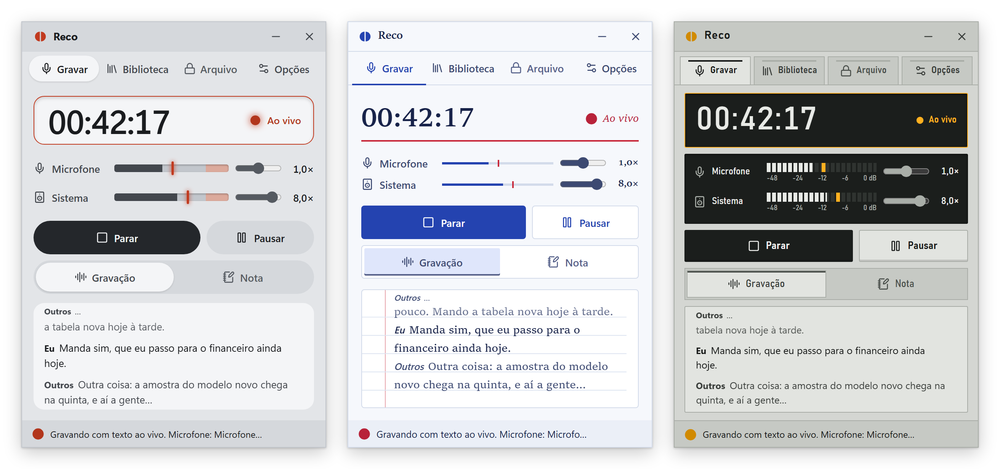
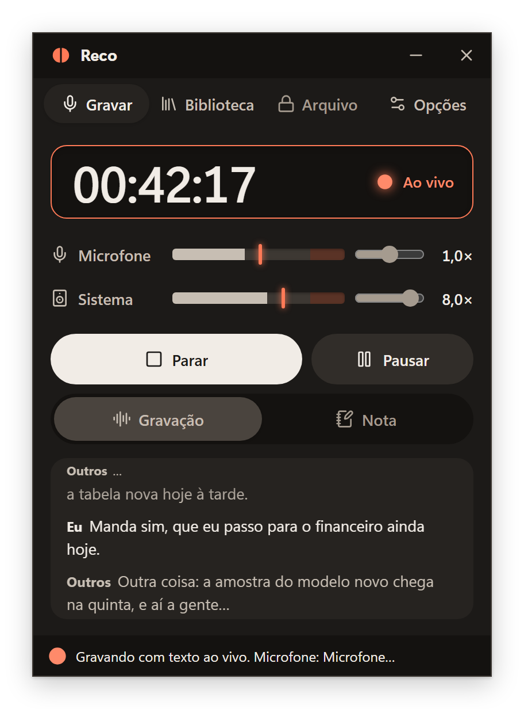
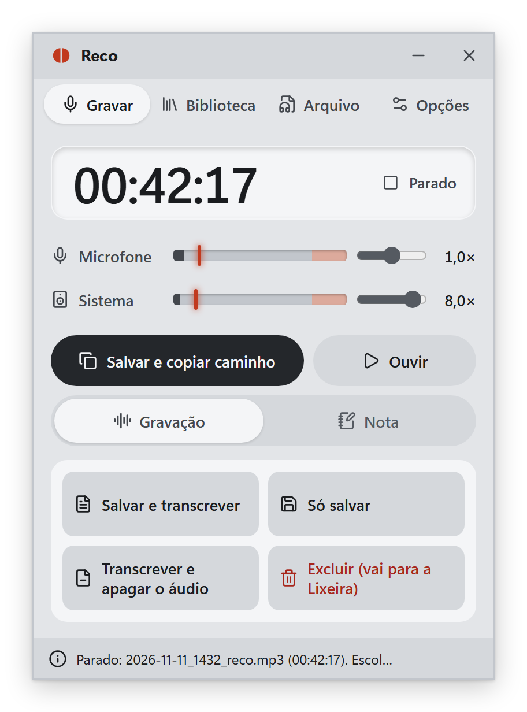
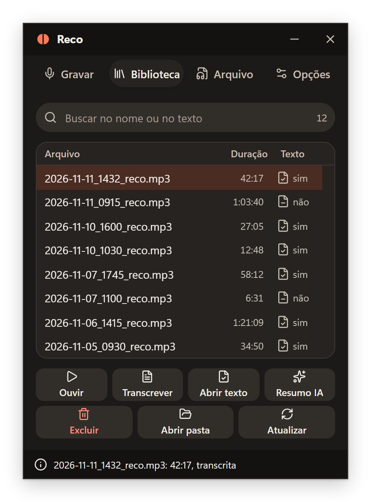
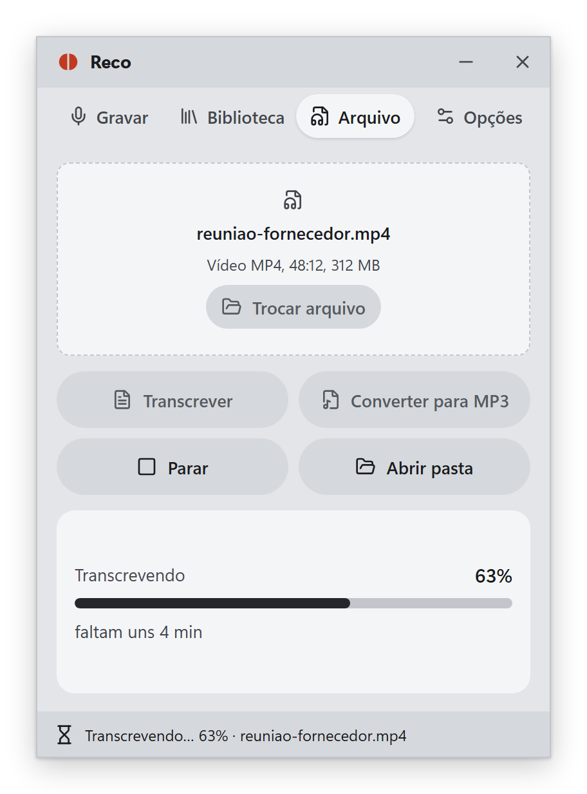

# Reco

**Records your microphone and your computer's audio together, then transcribes the call on your own PC, with who said what.**

**Grava o microfone e o áudio do computador juntos e transcreve a conversa no seu próprio PC, com quem falou o quê.**

<p align="center">

</p>

Windows 10/11 · any x64 CPU (GPU and NPU acceleration on Intel only) · local Whisper on OpenVINO · Portuguese or English · [MIT](LICENSE)

**Status:** no installer for this version yet. [Build it from source](#install), or use the
[v0.2.0 release](https://github.com/dosxnjos/reco/releases/tag/v0.2.0), which is the older Tkinter app.

**Estado:** ainda não há instalador desta versão. [Gere pelo código](#instalar) ou use o
[release v0.2.0](https://github.com/dosxnjos/reco/releases/tag/v0.2.0), que é o app antigo, em Tkinter.

### [English](#english) · [Português](#português)

<table>
<tr>
<td align="center" width="50%">
<br>
<sub>Recording with live text · Gravando com texto ao vivo</sub>
</td>
<td align="center" width="50%">
<br>
<sub>Stopped: save and copy the path, or choose another action · Parado: salvar e copiar o caminho, ou outra ação</sub>
</td>
</tr>
<tr>
<td align="center">
<br>
<sub>Library: search names and transcripts · Biblioteca: busca no nome e no texto</sub>
</td>
<td align="center">
<br>
<sub>File: transcribe or convert any audio or video · Arquivo: transcrever ou converter áudio e vídeo</sub>
</td>
</tr>
</table>

The captures show the interface in Portuguese; the app switches to English in Options.

---

## English

Reco is a small Windows tray app for calls. It records your microphone on the left channel and the computer's audio on
the right channel of one stereo MP3, so the transcript knows who spoke without guessing from voices. It captures the PC
audio directly, with no "Stereo Mix" to turn on. Transcription runs on your PC with Whisper `large-v3-turbo` through
OpenVINO GenAI: no account, no API key, and no audio leaves the machine. The network is used only to download the model
from Hugging Face, to check for a newer model and for new releases of this repo, and by the optional AI summary.

### Features

- **Record:** microphone and system audio in a 16 kHz stereo MP3 at 96 kbps, encoded while it records. Pause and
  resume, a level meter and a gain control (0× to 10×) per channel.
- **After you stop:** the main button saves the file and copies its full path in double quotes, ready to paste into a
  terminal or a chat. The other options are buttons on screen: save and transcribe, save only, transcribe and delete
  the audio, delete (to the Recycle Bin).
- **Note mode:** records the microphone only and turns the speech into a `.md` file.
- **Transcript:** a `.txt` next to the recording, labeled by channel ("Me" and "Speaker(s)"). Echo from speakers is
  removed when transcribing; the MP3 stays as recorded. Optional live text shows a draft while you record.
- **Language:** the transcript uses the app language (Portuguese or English, set in Options); switch it before
  transcribing a call in the other language.
- **File tab:** transcribe any audio or video file, or convert it to a light MP3.
- **Library:** search file names and transcript text; play, transcribe, open the text, delete. The optional **AI
  summary** uses your own [Claude Code](https://claude.com/claude-code) CLI and sends the transcript text (never the
  audio) to Claude under your account.
- **Window:** lives in the tray (hovering the icon shows it without taking focus, clicking pins it). Optional
  Ctrl+Shift+R shortcut and start with Windows. Three skins, set in [Options](docs/screenshots/options-skins.png):
  [Tape](docs/screenshots/skin-tape.png) (default), [Notebook](docs/screenshots/skin-notebook.png) and
  [Instrument](docs/screenshots/skin-instrument.png), each in light or dark.
- **Process on:** Auto (recommended; it prefers the Intel GPU), GPU, NPU or CPU. The NPU is experimental: with this
  model it failed on the test machine, and its first run spends several minutes compiling.
- Ready to record in under a second after opening.

### Install

Requirements: Windows 10/11 64-bit and any x64 CPU (GPU and NPU acceleration need Intel hardware). To build: Python 3.14
(the version it is built and tested with) with [requirements.txt](requirements.txt) and `pyinstaller`, Rust 1.90 or newer
(MSVC toolchain), and Node.js with npm.

```powershell
pip install -r requirements.txt pyinstaller
powershell -ExecutionPolicy Bypass -File app/build.ps1
# -> <CARGO_TARGET_DIR or app/src-tauri/target>\release\bundle\nsis\Reco_<version>_x64-setup.exe
```

The build takes about 6 to 11 minutes on the development machine; the installer is about 130 MB.

- It installs per user (no admin) to `%LOCALAPPDATA%\Reco`, with a Start Menu shortcut. A Desktop shortcut is optional
  (unchecked by default). The installer is not signed, so Windows SmartScreen may warn.
- The transcription model (about 0.8 GB) is downloaded once to `%LOCALAPPDATA%\Reco\models`. Uninstalling keeps it.

**Coming from v0.2.0?** Both apps use the same settings and recordings folder, and only one runs at a time: quit the
old one from its tray menu before opening the new one.

### How it works

A Tauri 2 shell in Rust (window, tray, shortcut, engine lifecycle) shows an interface in TypeScript and talks in JSON
Lines to a Python engine, which is the same recording and transcription code as the old app, frozen with PyInstaller.
Details: [docs/ARQUITETURA.md](docs/ARQUITETURA.md) and [docs/PROTOCOL.md](docs/PROTOCOL.md) (in Portuguese).

### For developers

Run the interface in a browser with a fake engine (`app/ui/src/mock.ts`):

```powershell
npm --prefix app install
npm --prefix app run ui:build
npm --prefix app run ui:preview   # http://127.0.0.1:1431
```

`?tela=gravar|biblioteca|arquivo|opcoes&estado=<state>&direcao=a|b|c&tema=claro|escuro|sistema` jumps to a state
(a = Tape, b = Notebook, c = Instrument; the states are in `app/ui/src/tipos.ts`). The screenshots come from it.

Tests: [docs/ARQUITETURA.md § Casco](docs/ARQUITETURA.md#casco-tauri-e-interface-nova-app-12112026). The interface
tests need Playwright (`npm i -g playwright` and `npx playwright install chromium`, or `PLAYWRIGHT_CORE` pointing to
it), and `cargo test -- --include-ignored` needs Python with `requirements.txt`. Screen rules and skins:
[design/DESIGN.md](design/DESIGN.md).

### History

Reco started in 2026 as a Python/Tkinter app (`reco.py`, still in this repo, runs with `python reco.py`), released up
to v0.2.0. In November 2026 its interface was rebuilt as a Tauri shell over the same Python engine, with a fixed-size
window and three skins.

---

## Português

O Reco é um app pequeno de bandeja para Windows, feito para chamadas. Ele grava o seu microfone no canal esquerdo e o
áudio do computador no canal direito de um MP3 estéreo, então a transcrição sabe quem falou sem adivinhar pela voz. Ele
grava o som do PC direto, sem precisar ativar a "Mixagem estéreo". A transcrição roda no seu PC com o Whisper
`large-v3-turbo` pelo OpenVINO GenAI: sem conta, sem chave de API, e nenhum áudio sai da máquina. A rede só é usada para
baixar o modelo do Hugging Face, ver se há modelo novo ou release novo deste repositório e no Resumo IA opcional.

### Recursos

- **Gravar:** microfone e áudio do sistema num MP3 estéreo de 16 kHz a 96 kbps, codificado enquanto grava. Pausar e
  continuar, medidor de nível e controle de ganho (0× a 10×) por canal.
- **Depois de parar:** o botão principal salva o arquivo e copia o caminho completo entre aspas duplas, pronto para colar
  no terminal ou no chat. As outras ações são botões na tela: salvar e transcrever, só salvar, transcrever e apagar o
  áudio, excluir (vai para a Lixeira).
- **Modo Nota:** grava só o microfone e transforma a fala num arquivo `.md`.
- **Transcrição:** um `.txt` ao lado da gravação, com cada fala marcada pelo canal ("Eu" e "Interlocutor(es)"). O eco da
  caixa de som sai na hora de transcrever; o MP3 fica como foi gravado. O texto ao vivo, opcional, mostra um rascunho
  enquanto grava.
- **Idioma:** a transcrição usa o idioma do app (português ou inglês, em Opções); troque antes de transcrever uma
  conversa na outra língua.
- **Aba Arquivo:** transcreve qualquer arquivo de áudio ou vídeo, ou converte para um MP3 leve.
- **Biblioteca:** busca no nome do arquivo e no texto transcrito; ouvir, transcrever, abrir o texto, excluir. O **Resumo
  IA**, opcional, usa o [Claude Code](https://claude.com/claude-code) do seu computador e manda o texto da transcrição
  (nunca o áudio) para o Claude, na sua conta.
- **Janela:** mora na bandeja (passar o mouse no ícone mostra a janela sem roubar o foco, clicar fixa). Atalho
  Ctrl+Shift+R e iniciar com o Windows, os dois opcionais. Três skins, escolhidas em
  [Opções](docs/screenshots/options-skins.png): [Fita](docs/screenshots/skin-tape.png) (padrão),
  [Caderno](docs/screenshots/skin-notebook.png) e [Instrumento](docs/screenshots/skin-instrument.png), em claro ou escuro.
- **Processar em:** Auto (o recomendado; prefere a GPU da Intel), GPU, NPU ou CPU. A NPU é experimental: com este modelo
  ela falhou na máquina de teste, e a primeira vez nela passa alguns minutos compilando.
- Pronto para gravar em menos de 1 s depois de abrir.

### Instalar

Requisitos: Windows 10/11 de 64 bits e qualquer CPU x64 (GPU e NPU só aceleram em hardware Intel). Para gerar o
instalador: Python 3.14 (a versão com que é gerado e testado) com o [requirements.txt](requirements.txt) e o
`pyinstaller`, Rust 1.90 ou mais novo (toolchain MSVC) e Node.js com npm.

```powershell
pip install -r requirements.txt pyinstaller
powershell -ExecutionPolicy Bypass -File app/build.ps1
# -> <CARGO_TARGET_DIR ou app/src-tauri/target>\release\bundle\nsis\Reco_<versão>_x64-setup.exe
```

O build leva uns 6 a 11 minutos na máquina de desenvolvimento; o instalador fica com uns 130 MB.

- Instala por usuário (sem administrador) em `%LOCALAPPDATA%\Reco`, com atalho no Menu Iniciar. O atalho na Área de
  Trabalho é opcional (vem desmarcado). O instalador não é assinado, então o SmartScreen do Windows pode avisar.
- O modelo de transcrição (uns 0,8 GB) é baixado uma vez para `%LOCALAPPDATA%\Reco\models`. Desinstalar mantém essa pasta.

**Vindo da v0.2.0?** Os dois apps usam a mesma configuração e a mesma pasta de gravações, e só um roda por vez: saia do
antigo pelo menu da bandeja antes de abrir o novo.

### Como funciona

Um shell Tauri 2 em Rust (janela, bandeja, atalho, ciclo de vida do motor) mostra a interface em TypeScript e conversa em
JSON Lines com um motor em Python, que é o mesmo código de gravação e transcrição do app antigo, congelado com o
PyInstaller. Detalhes: [docs/ARQUITETURA.md](docs/ARQUITETURA.md) e [docs/PROTOCOL.md](docs/PROTOCOL.md).

### Para quem desenvolve

A interface roda no navegador com um motor falso; os comandos estão em [For developers](#for-developers). Na URL,
`direcao=a|b|c` escolhe a skin (a = Fita, b = Caderno, c = Instrumento). Testes e o que cada um prova:
[docs/ARQUITETURA.md § Casco](docs/ARQUITETURA.md#casco-tauri-e-interface-nova-app-12112026).

### Histórico

O Reco começou em 2026 como um app em Python/Tkinter (`reco.py`, que continua neste repositório e roda com
`python reco.py`), publicado até a v0.2.0. Em novembro de 2026 a interface foi refeita como um shell Tauri sobre o mesmo
motor em Python, com janela de tamanho fixo e três skins.
